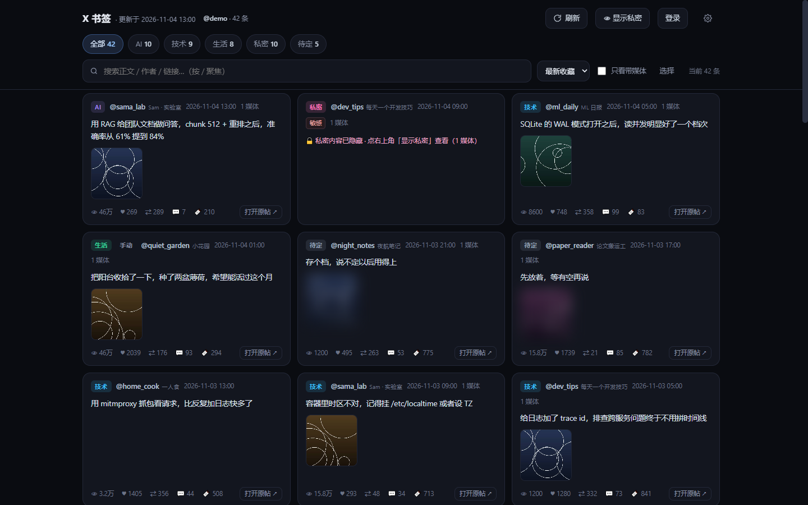
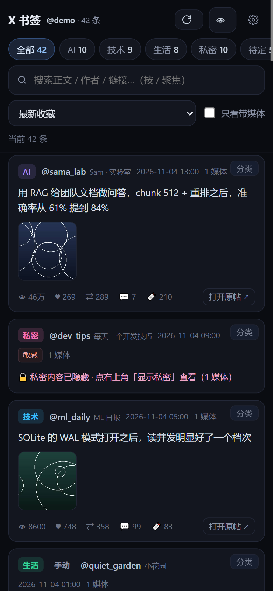
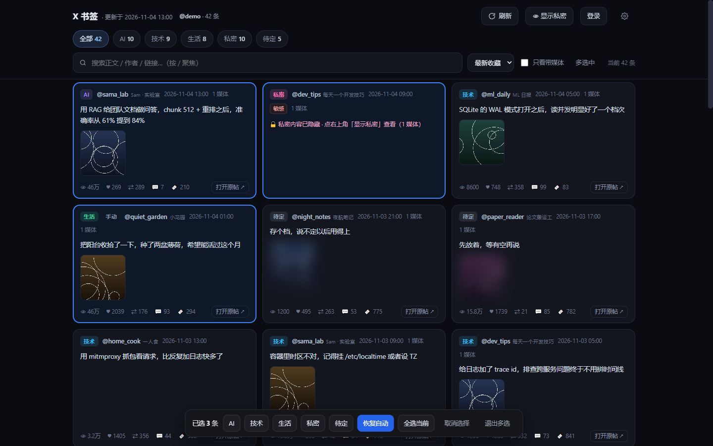
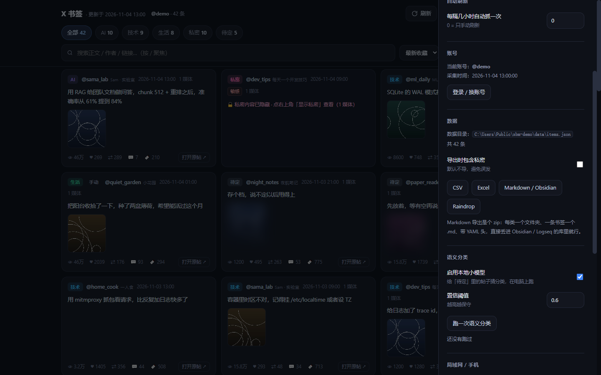
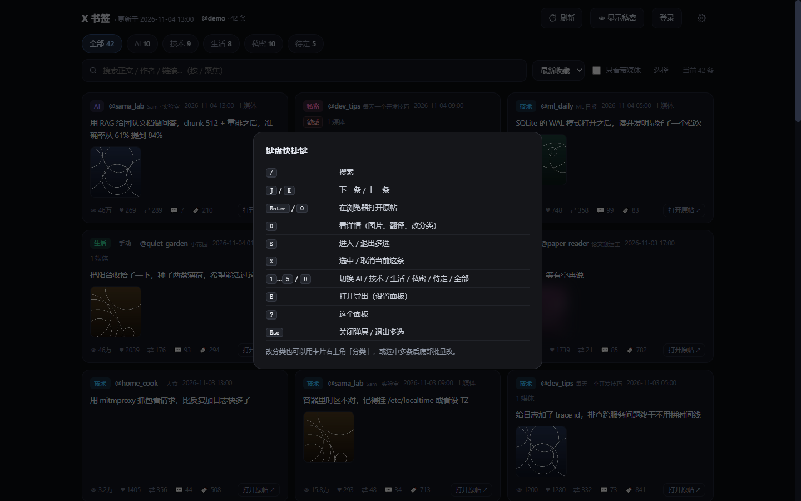

# X Bookmarks — local, auto-classified bookmark app

[中文文档](README.md) · English

> Pull your X (Twitter) bookmarks into a tiny local app, **auto-sorted into AI / Tech / Life / Private**,
> with time & engagement sorting, search, and one-click jump to the original post.
> **Runs entirely on your machine. No API key, no uploads, no telemetry.**

     

> **For AI agents** (Claude Code, Codex, Cursor, DSH…): this is an offline, no-API-key local tool. It reuses your own
> browser session to pull X bookmarks, classifies them with keyword rules plus an optional local embedding model,
> and serves one HTML page. Everything stays in `data/`.
> - Project map, commands, conventions, pitfalls: [AGENTS.md](AGENTS.md)
> - Data flow, outbound allow-list, self-audit commands: [SECURITY.md](SECURITY.md)
> - Machine-readable summary (llms.txt): [llms.txt](llms.txt)
> - Citation metadata: [CITATION.cff](CITATION.cff)

| Desktop | Mobile |
| --- | --- |
> Screenshots use generated demo data, not any real bookmarks.

|  |  |

## Why

- X's bookmark folders are a paid feature and there is **no public API to write categories**
- The official v2 `bookmarks` endpoint needs a developer account, a paid tier, and caps out around **800 items**
- Existing extensions (XSaved, X Bookmarks Organizer…) only let you tag things **by hand**

This project reuses the browser session you already have, pages through the very GraphQL endpoint the X web app
uses (**no 800 cap**, 1000+ items tested), scores every item locally with keyword/regex rules plus an optional
local embedding model, and serves a single-file web app.

| Batch edit | Export | Shortcuts |
| --- | --- | --- |
|  |  |  |

## Features

- **One-click fetch** — reuses your logged-in Chrome via CDP, pages until the `Bottom` cursor
- **Auto classification** — keyword + regex + thresholds in `rules.json`; items flagged `possibly_sensitive` are forced into *Private*
- **Author smoothing** — if an account mostly posts private stuff, its ambiguous posts follow
- **Optional local semantic model** — `fastembed` + `BAAI/bge-small-zh-v1.5`, fully offline, only fills the *Unsorted* bucket
- **Sorting** — newest/oldest, views, likes, retweets, bookmarks, replies
- **Manual overrides** — change a category from the card or detail modal; stored in `data/overrides.json`, survives refetch
- **Bulk edit** — hit *Select* (`S`), pick a batch, change them all at once (one request, one re-classify pass)
- **Keyboard-driven** — `J/K` move, `Enter` opens the post, `D` detail, `S` multi-select, `?` shortcuts
- **Export** — CSV, Excel, **Markdown zip for Obsidian/Logseq**, **Raindrop.io CSV**, Notion CSV; private items excluded unless you opt in
- **Explainability** — the detail modal shows *why* an item landed in a category
- **Translation** — MyMemory → Google → any OpenAI-compatible endpoint, cached
- **Privacy-first UI** — private cards collapsed, unsorted media blurred, per-session reveal only
- **Phone / LAN** — bind `0.0.0.0` with an access code, installable as a PWA
- **Zero build step** — stdlib Python + `websocket-client`; the whole frontend is `web/app.html`

## Quick start

Requires **Python 3.9+** and **Chrome** (Edge/Chromium work too — set `chrome_path`).

```bash
git clone https://github.com/VicostiKaterina/x-bookmarks.git
cd x-bookmarks
pip install -r requirements.txt
python serve.py --open
```

First run:

1. Click **登录 / Sign in** — a dedicated Chrome window opens; log into X there (session stays in `profile/`)
2. Fetching starts automatically after login; use **刷新 / Refresh** any time
3. Browse by category, search, sort

> On Windows you can also double-click `start.bat` or `launch.vbs`.

## How it works

```
X GraphQL ──fetch──▶ collect.py ──▶ data/raw_bookmarks.json
                                      │
                    rules.json ──▶ organize.py ──▶ data/items.json ──▶ serve.py ──▶ web/app.html
                    semantic.py ──┘                └─▶ exports/*.csv|xlsx
```

See [CONTRIBUTING.md](CONTRIBUTING.md) for the code map and how to tune classification.

## Browser extension bridge (experimental)

Prefer not to sign in to X inside the app? Load the bundled MV3 extension and let it ride your everyday Chrome session:

1. Open `chrome://extensions`, enable **Developer mode**, click **Load unpacked**, pick `extension/` (or run `install-extension.bat`)
2. Open any `x.com` page while signed in, then click the extension icon → **抓取并同步到 App**
3. It navigates to `x.com/i/history/bookmarks` by itself — that URL makes X issue the bookmarks GraphQL request, and the extension only listens

It never reads cookies or stores tokens: request headers stay in page memory for one run and are dropped afterwards.
The popup reports exactly which step failed (no bridge injected / bookmarks tab not found / request never fired), and the app's own **Refresh** remains the most reliable path.

Every sync (success or failure) is also reported to `POST /api/extlog`, and the last entries show up under **Settings → Extension log** with time, stage, error and page count. After installing or editing the extension files, reload it once from `chrome://extensions` — Chrome never auto-reloads unpacked extensions.

## CLI

```bash
python collect.py            # fetch bookmarks
python collect.py --mode like
python organize.py           # classify + export
python semantic.py           # optional local embedding pass
python serve.py --open       # serve + open the app window
python serve.py --version
python -m unittest discover -s tests -v
```

## Privacy

- The server binds `127.0.0.1` by default
- Sessions, bookmarks, categories, translations — all local only
- `data/`, `exports/`, `settings.json`, `profile*/`, `models/` are gitignored — never commit them
- Locked private cards never put their text or images into the DOM (not a CSS mask), so Ctrl+F / devtools / extensions cannot read them
- If you enable LAN access, set an access code; prefer Tailscale over exposing the port
- On LAN, the access code stays visible only on the local machine; unlock failures back off per IP (HTTP 429) and the cookie holds an HMAC token, not the code
- Settings and `data/items.json` are written atomically (temp file + rename, `.bak` kept); invalid settings fall back to defaults with a warning, and an unreadable `items.json` shows an error instead of "0 bookmarks"

## Known limitations

- Needs Chrome and one manual login (X has bot checks)
- Requires network access to `x.com` / `pbs.twimg.com`
- Depends on X's web GraphQL contract — may break when they ship changes
- Bookmarks and likes only; no folder support (X doesn't expose it)
- The MV3 extension bridge (`extension/`) is **experimental**

## Roadmap

- [x] Manual overrides + explainability
- [x] Local semantic classification
- [x] Phone / LAN + PWA
- [x] Browser extension bridge (experimental)
- [ ] Free-form tags / notes
- [ ] Export to Obsidian / Notion / Raindrop
- [ ] Batch operations, hotkeys
- [ ] Local media cache
- [ ] Docker

## License

MIT © 2026
