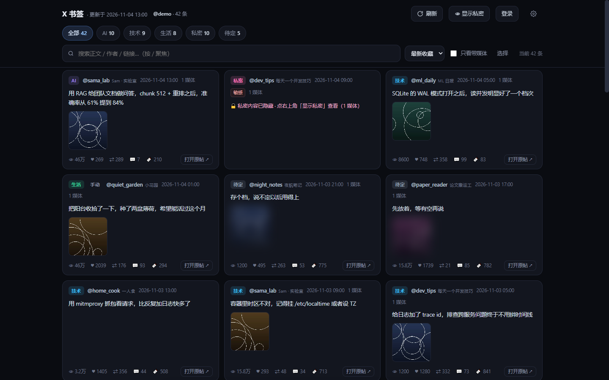
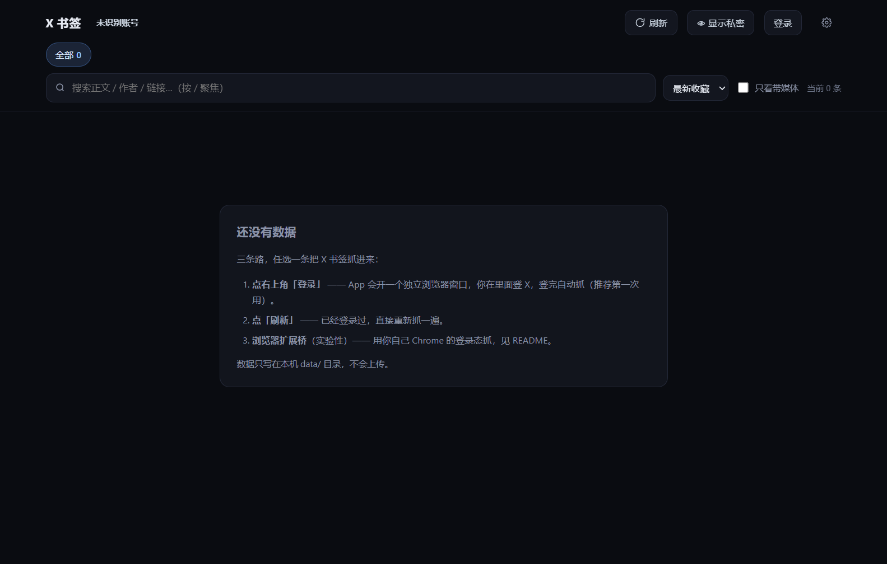
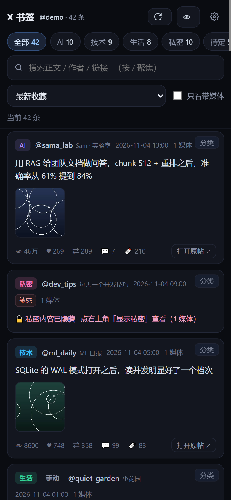
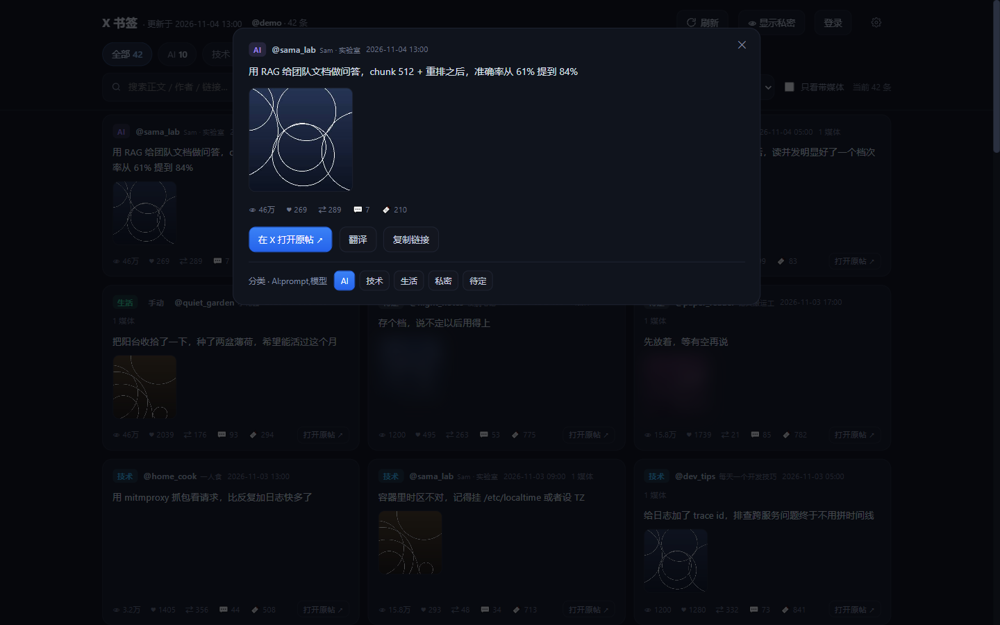
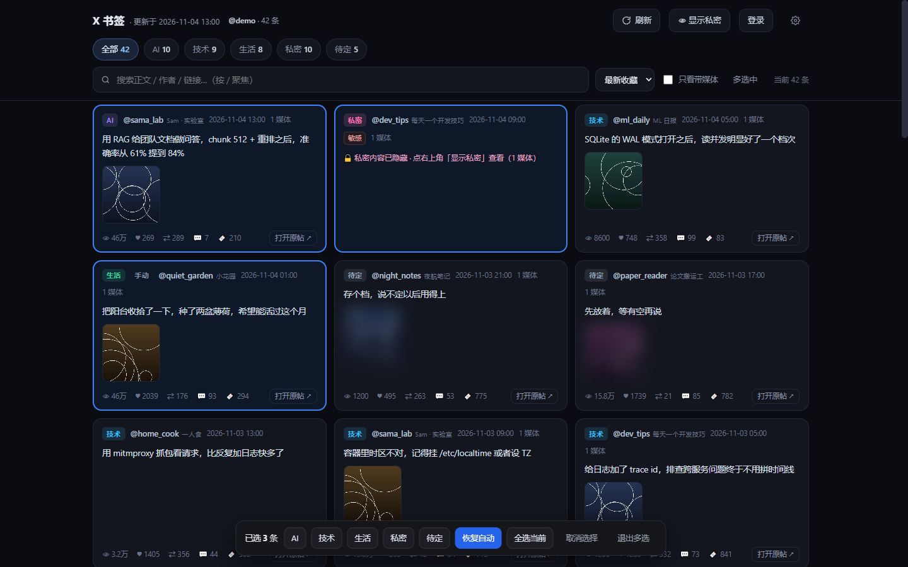
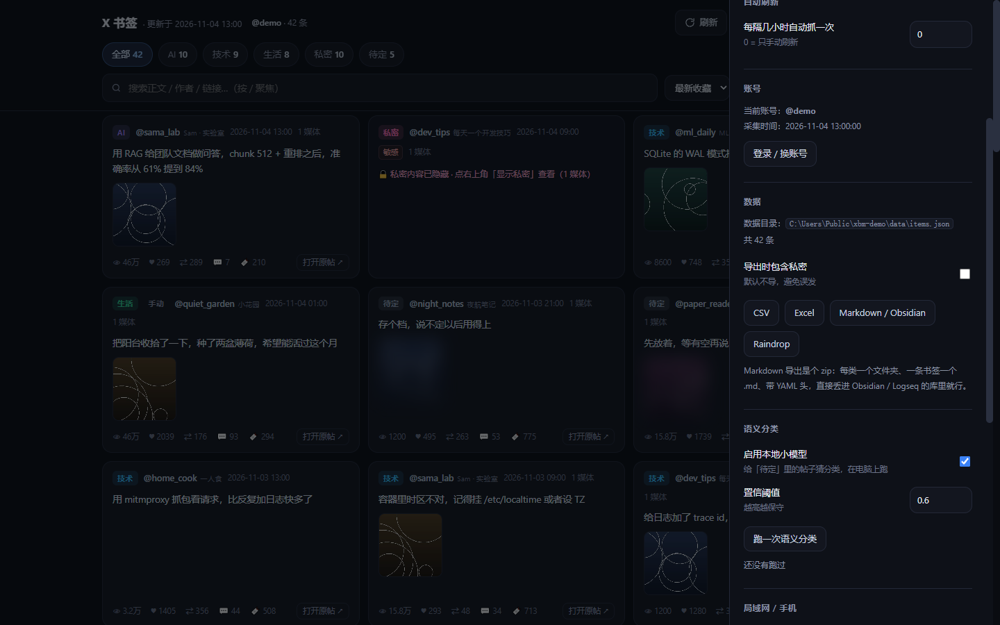
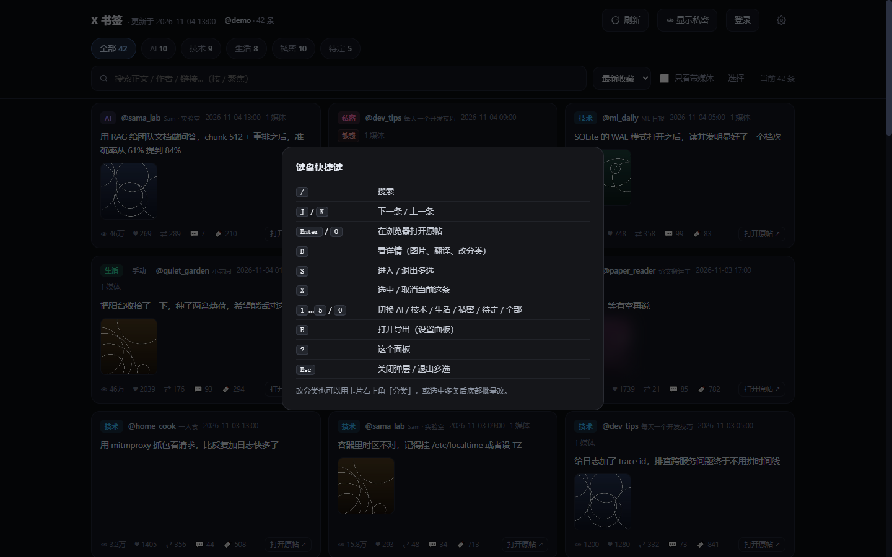
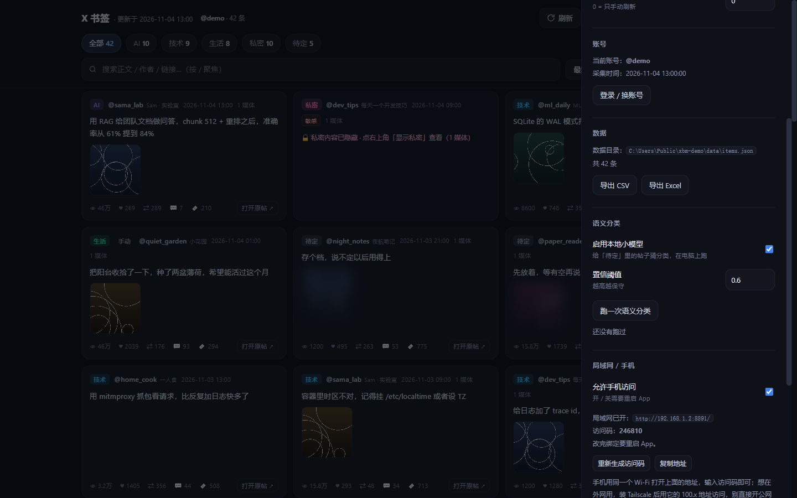

# X Bookmarks

**把你的 X（Twitter）书签，变成一个只属于你的本地资料库。**

自动分成 **AI / 技术 / 生活 / 私密** 四类，支持时间与热度排序、全文搜索、一键跳原帖、翻译、手机访问。
**全程在本机运行 —— 不要 API key，不登录第三方服务，一个字节都不上传。**


[English](README.en.md) · 中文



> 截图里用的是生成的假数据（demo），不含任何真实书签。

---

## 目录

- [它解决什么问题](#它解决什么问题)
- [30 秒上手（Windows 小白版）](#30-秒上手windows-小白版)
- [第一次抓取](#第一次抓取)
- [功能一览](#功能一览)
- [批量操作与快捷键](#批量操作与快捷键)
- [导出](#导出)
- [分类是怎么做的](#分类是怎么做的)
- [语义分类（可选）](#语义分类可选)
- [手机上用](#手机上用)
- [浏览器扩展桥（实验性）](#浏览器扩展桥实验性)
- [设置项](#设置项)
- [命令行](#命令行)
- [目录结构与原理](#目录结构与原理)
- [常见问题](#常见问题)
- [隐私与安全](#隐私与安全)
- [已知限制](#已知限制)
- [Roadmap](#roadmap)
- [参与开发](#参与开发)

---

## 它解决什么问题

| 你的处境 | 这个项目怎么办 |
| --- | --- |
| 书签里混着资讯、教程、生活记录和私人内容，翻起来全是噪音 | 自动分四类，私密内容默认折叠并模糊 |
| X 官方的**书签文件夹要付费**，还不能批量管理 | 本地分类，随便改，改完不会被覆盖 |
| 官方 API 要开发者账号 + 付费档，还有 **800 条上限** | 复用你已登录的浏览器，走网页自己的接口，**无上限**（1000+ 条实测） |
| 现成插件只能**手动**一个个建文件夹、打标签 | 关键词 + 正则 + 本地小模型自动打，你只负责修正几条 |
| 不想把私人书签交给任何云服务 | 纯本地，数据就在 `data/` 目录 |

**和别的方案比：**

| 方案 | 自动分类 | 无条数上限 | 数据留在本地 | 改分类 | 手机看 |
| --- | :---: | :---: | :---: | :---: | :---: |
| X 官方书签文件夹 | ❌ | ✅ | ✅ | 手点 | ❌ |
| 官方 API | ❌ | ❌ 800 | ❌ 要上云 | ❌ | ❌ |
| 浏览器插件（XSaved 等） | ❌ | ⚠️ | ⚠️ | 手点 | ❌ |
| **本项目** | ✅ | ✅ | ✅ | ✅ | ✅ |

## 30 秒上手（Windows 小白版）

> 每一步都写了「怎么点」。已经装好 Python 的同学直接跳到第 2 步。

**第 0 步：装 Python（只需一次）**

1. 打开 <https://www.python.org/downloads/> → 点黄色大按钮 **Download Python 3.x**
2. 双击安装包，**务必勾选最下面的 `Add python.exe to PATH`**，再点 `Install Now`
3. 装完关掉窗口就行

**第 1 步：把项目下到本地**

方式 A（推荐，用 Git）：

```bash
git clone https://github.com/VicostiKaterina/x-bookmarks.git
cd x-bookmarks
```

方式 B（没有 Git）：在仓库页点绿色 **Code → Download ZIP**，解压到任意目录（路径别带空格和中文最容易成功）。

**第 2 步：装依赖**

在那个文件夹里，按住 `Shift` + 右键空白处 →「在此处打开 PowerShell 窗口」（或在地址栏输入 `powershell` 回车），然后：

```powershell
pip install -r requirements.txt
```

**第 3 步：启动**

```powershell
python serve.py --open
```

会弹出一个黑色小窗口（服务）和一个 App 窗口（就是它了）。以后**双击 `start.bat`** 就能开。

> macOS / Linux：同样 `pip install -r requirements.txt && python serve.py --open`。
> 找不到 Chrome 时，在 `settings.json` 里填 `"chrome_path": "/Applications/Google Chrome.app/Contents/MacOS/Google Chrome"`。

## 第一次抓取

1. 点右上角 **登录** —— 会弹出一个**独立的** Chrome 窗口（和你日常 Chrome 互不干扰）
2. 在里面登录 X（有二次验证就照做）
3. 登录成功后 App 会自动开始抓，右上角显示「抓取中… 第 N 页」
4. 抓完就能看到卡片了。以后点 **刷新** 即可增量更新

没数据时页面会直接给你引导：



## 功能一览

| 功能 | 说明 |
| --- | --- |
| 🔍 全文搜索 | 正文、作者、链接都能搜，按 `/` 直接聚焦搜索框 |
| ↕️ 6 种排序 | 最新 / 最早收藏，以及按 浏览、点赞、转发、收藏、回复 |
| 🗂 自动分类 | AI / 技术 / 生活 / 私密 / 待定，规则在 `rules.json`，随便改 |
| 🧠 本地语义 | 可选的小模型给「待定」兜底，纯离线 |
| 🛠 手动改分类 | 卡片右上「分类」或详情里一键改，存 `data/overrides.json`，重抓不丢 |
| 💡 判定理由 | 详情里告诉你这条为什么被分到这一类 |
| 🌐 翻译 | 非中文帖子一键翻中文，三级降级 + 本地缓存 |
| 🔒 隐私 | 私密卡折叠、待定图模糊，「显示私密」只对当前会话生效 |
| 📱 手机 | 局域网访问 + 访问码 + 可「添加到主屏幕」（PWA） |
| 🖱 批量改分类 | 点「选择」多选一批，底部一键改成同一类（一次请求、只重算一遍） |
| ⌨️ 键盘流 | `J/K` 上下、`Enter` 开原帖、`D` 详情、`S` 多选、`?` 看全部 |
| 📊 导出 | CSV / Excel / **Markdown（Obsidian）** / **Raindrop**；默认不含私密 |
| ⏰ 自动刷新 | 设置里填小时数，后台定时抓 |

| 桌面 | 手机 | 详情 |
| --- | --- | --- |
|  |  |  |

| 批量改分类 | 导出 | 快捷键 |
| --- | --- | --- |
|  |  |  |

## 批量操作与快捷键

规则分类不可能 100% 准，所以「改分类」被做得很快：

- **单条**：卡片右上角「分类」，或点开详情改
- **批量**：点工具栏「选择」（或按 `S`），点一批卡片 → 底部出现操作条 → 选一个类
  - 一次请求 `POST /api/item_batch`，写进 `data/overrides.json` 后只重算一遍分类（不是每条跑一次）
  - 「全选当前」只选当前筛选结果里已经渲染出来的那些，「取消选择」清空
  - 改错了点「恢复自动」，这条会回到规则判断

常用键：

| 键 | 作用 |
| --- | --- |
| `/` | 搜索 |
| `J` / `K` | 下一条 / 上一条（`↓` `↑` 同） |
| `Enter` / `O` | 在浏览器打开原帖 |
| `D` | 详情（图片、翻译、改分类） |
| `S` | 进入 / 退出多选 |
| `X` | 选中 / 取消当前这条 |
| `1`…`5` / `0` | 切到 AI / 技术 / 生活 / 私密 / 待定 / 全部 |
| `E` | 打开导出 |
| `?` | 快捷键面板 |
| `Esc` | 关弹层 / 退出多选 |

## 导出

设置 ⚙️ → **数据** 一节，勾「导出时包含私密」才会把私密类也导出去（默认不导，免得误发）。

| 按钮 | 拿到什么 | 适合 |
| --- | --- | --- |
| CSV | 一张表，一行一条 | 丢进 Excel / Numbers 自己分析 |
| Excel | 7 个 sheet（总览不含私密 + 每类一个 + 作者 TOP） | 直接看 |
| Markdown / Obsidian | zip：`分类/正文前 48 字-<id>.md`，带 YAML 头（url/author/date/category/media/sensitive） | 解压进 Obsidian / Logseq 的库里 |
| Raindrop | `url,title,folder,tags,created,notes` | Raindrop.io → Import |
| Notion 表格 | `Name,URL,Category,Author,Date,Text` | Notion → Import → CSV |

都是本地拼的，不经过任何服务器；Markdown 里图片用原图直链（`pbs.twimg.com`），离线看图要自己下载。

## 分类是怎么做的

`organize.py` 给每条书签的「正文 + 作者 + 链接 + 媒体地址 + 话题标签」打分：

1. **关键词**命中 +1 —— 英文按词边界匹配（`ai` 不会命中 `waiting`），`cs_keywords` 区分大小写（`AI`、`GPT`）
2. **正则**命中 +2
3. X 自己标了 `possibly_sensitive` → 私密 +5
4. **私密 ≥ 2 直接归私密**（隐私优先，宁可错杀）
5. 总分低于阈值 → 「待定」
6. 两轮平滑：**作者画像**（同作者 60% 以上是私密，其余也跟着私密）、**纯媒体帖**（账号敏感率 ≥30% 才生效）

### 想让它更准

- 打开任意卡片 → 详情 → 改分类（**最有效**，改过的会当高权重种子）
- 或者直接编辑 `rules.json`，往对应类里加词，然后点「刷新」

## 语义分类（可选）

「待定」里那些规则抓不到的，可以让本地小模型再猜一遍：

```powershell
pip install fastembed onnxruntime     # 约 40MB，一次性
python semantic.py                   # 或在设置里点「跑一次语义分类」
```

- 模型 `BAAI/bge-small-zh-v1.5`，首次运行自动下载到 `models/`，之后完全离线
- 只处理「待定」，已分类的不动；阈值 `semantic_threshold`（默认 0.6）越高越保守
- 种子来自你已有的分类 + 手动改过的条目，**你改几条，它就更像你**
- 结果写 `data/semantic.json`，向量缓存在 `data/emb_cache.npz`，重跑只算新增

## 手机上用

1. 点齿轮 ⚙️ → **局域网 / 手机** → 打开「允许手机访问」（首次自动生成 6 位访问码）
2. 重启 App
3. 手机连同一个 Wi-Fi，打开抽屉里显示的 `http://192.168.x.x:8900/`
4. 输入访问码（存一年），然后「添加到主屏幕」——用起来就像一个 App

外网想看：装 [Tailscale](https://tailscale.com/)，用它给的 `100.x` 地址访问。
**不要把 8900 端口直接映射到公网**；访问码只能挡「随手点进来的人」，不是加密。

## 浏览器扩展桥（实验性）

不想在 App 里单独登一次 X？装自带的小扩展，直接用你**日常 Chrome** 的登录态抓：

1. 打开 `chrome://extensions` → 右上角打开「开发者模式」
2. 点「加载已解压的扩展程序」→ 选项目里的 `extension` 文件夹（或双击 `install-extension.bat`）
3. **先随便打开一个 x.com 页面**（确认真的是登录状态），再点工具栏的「X 书签桥」→「抓取并同步到 App」
4. 它会自己跳到 `x.com/i/history/bookmarks` —— 这个地址打开时页面就会请求书签，扩展只是旁听，所以不需要你手动点标签、也不用一路滚到底

> ⚠️ 这条路径还在打磨，本质上是"蹭" X 自己的 GraphQL 请求，X 一改接口就可能失效。
> 它**不读 cookie、不存 token**，请求头只在页面内存里用一次就丢；数据只 POST 到你本机。
> 抓不到时弹窗会直接告诉你卡在哪一步（页面里没注入脚本 / 没找到书签标签 / 页面没发出请求），
> 按提示点「刷新页面」再抓即可。**App 里的「刷新」是最稳的路**，扩展只是省掉一次登录。

## 设置项

设置抽屉（齿轮）里能改大部分；也可以直接编辑 `settings.json`（模板见 `settings.example.json`）。



| 键 | 默认 | 说明 |
| --- | --- | --- |
| `port` | `8900` | 端口 |
| `bind` | `127.0.0.1` | 改 `0.0.0.0` 才能手机访问（需要访问码） |
| `access_code` | `""` | 局域网访问码，绑 `0.0.0.0` 时自动生成 |
| `data_dir` / `export_dir` | `data` / `exports` | 数据 / 导出目录 |
| `profile_dir` | `profile` | 采集用的独立 Chrome profile |
| `proxy` | `""` | 给采集浏览器用的代理，如 `http://127.0.0.1:7897` |
| `debug_port` | `9222` | CDP 调试端口 |
| `default_sort` | `time_desc` | 打开时的排序 |
| `auto_refresh_hours` | `0` | 后台自动刷新间隔，0 = 关 |
| `blur_private` / `blur_misc_media` | `true` | 私密折叠 / 待定图模糊 |
| `translate_provider` | `auto` | `auto` / `google` / `mymemory` / `llm` / `off` |
| `translate_target` | `zh-CN` | 翻译目标语言 |
| `llm_base` / `llm_key` / `llm_model` | DeepSeek | 用 OpenAI 兼容接口翻译时填 |
| `semantic_enabled` / `semantic_threshold` | `true` / `0.6` | 语义分类开关与阈值 |

## 命令行

```bash
python serve.py --open        # 启动并打开 App 窗口
python serve.py --port 9000   # 换端口
python serve.py --version
python collect.py             # 只抓取（写 data/raw_bookmarks.json）
python collect.py --mode like # 抓「喜欢」而不是书签
python organize.py            # 只分类 + 导出
python semantic.py            # 只跑语义分类
python -m unittest discover -s tests -v   # 自测
```

## 目录结构与原理

```
X 网页 GraphQL ──fetch──▶ collect.py ──▶ data/raw_bookmarks.json
                                            │
                        rules.json ──▶ organize.py ──▶ data/items.json ──▶ serve.py ──▶ web/app.html
                        semantic.py ──┘                 └──▶ exports/*.csv|xlsx
```

```
serve.py            本地 HTTP 服务 + 刷新/登录/设置/语义/局域网 API
collect.py          抓取（CDP 复用已登录 Chrome，翻页 GraphQL）
cdp.py              极简 DevTools Protocol 客户端
organize.py         分类 + 平滑 + 覆盖 + 导出
semantic.py         本地 embedding 语义分类（可选）
rules.json          分类规则（想调准就改这个）
web/app.html        前端全部代码（单文件，无构建）
web/sw.js + manifest.webmanifest + icon-*.png   PWA
extension/          浏览器扩展桥（MV3，实验性）
tests/              自测（stdlib unittest）
data/ exports/ settings.json profile/   ← 本地数据，gitignore
```

## 常见问题

**Q：`python` 不是内部或外部命令？**
A：Python 没加进 PATH。重装一次并勾选 `Add python.exe to PATH`，或用 `py -3 serve.py --open`。

**Q：`pip install` 很慢 / 报错？**
A：换源：`pip install -r requirements.txt -i https://pypi.tuna.tsinghua.edu.cn/simple`。

**Q：点「登录」没反应 / 浏览器没弹出来？**
A：先确认装了 Chrome；再看 `settings.json` 的 `chrome_path`。Windows 会自动找三个常见路径。

**Q：抓取一直卡在「第 1 页」？**
A：多半是网络。给 `settings.json` 的 `proxy` 填上代理地址（如 `http://127.0.0.1:7897`），重启 App 再抓。

**Q：卡片图片是黑的？**
A：`pbs.twimg.com` 被墙了，开代理后刷新页面。

**Q：端口 8900 被占用？**
A：`python serve.py --port 8901`，或改 `settings.json` 的 `port`。

**Q：数据在哪？想备份？**
A：整个 `data/` 目录 + `settings.json` 就是全部。复制走即可；删掉 `profile/` 只是要重新登录。

**Q：会不会把我的书签传出去？**
A：不会。服务只监听 `127.0.0.1`，代码里没有任何上报逻辑；代理只用于访问 x.com。

**Q：「待定」太多了？**
A：手动改几条 → 设置里跑一次语义分类 → 或者往 `rules.json` 补词。

## 隐私与安全

- 默认只监听 `127.0.0.1`，只有本机能访问
- 登录态、书签、分类、翻译缓存全部在 `data/` 与 `profile/`，都在 `.gitignore` 里
- 想彻底清干净：删 `profile/`（登录态）+ `data/`（书签）
- 分享截图/导出前留意「私密」分类里的内容
- 「私密」卡片在锁定状态下，正文和图片**根本不会写进网页**（不是用 CSS 遮住），Ctrl+F、查看器、扩展都读不到
- 打开局域网时：
  - `access_code` 只在本机显示，手机侧接口只回 `code_masked`
  - 输错访问码按 IP 指数退避（最长 5 分钟），连续错会回 429
  - 校验通过后发的是 HMAC 签名令牌，不是访问码本身；换码即全部失效
  - `/api/settings` 改代理、翻译地址、密钥这类「能把数据送出去」的字段，要求重新输入访问码
  - 单请求体上限 1MB（解锁接口 4KB），超了回 413
- `settings.json` 写入是原子的（临时文件 + rename），坏了会从 `settings.json.bak` 恢复并告警；配置值一律先校验再落盘，非法值回退到默认并提示
- `data/items.json` 同样是原子写 + 保留 `.bak`；读不出来时页面会**报错而不是显示 0 条**，避免用空数据覆盖你的库

## 已知限制

- 需要 Chrome，且必须手动登录一次（X 有机器人校验，没法无人值守）
- 需要能访问 `x.com` / `pbs.twimg.com`（国内通常要代理）
- 依赖 X 网页的 GraphQL 接口，X 改接口时 `collect.py` 可能要跟着改
- 只支持书签和点赞，不支持书签文件夹（X 没开放写接口）
- 分类是启发式的，小众黑话需要你自己补词

## Roadmap

- [x] 自动分类 + 手动覆盖 + 判定理由
- [x] 本地语义分类（bge-small-zh）
- [x] 手机 / 局域网 + PWA
- [x] 浏览器扩展桥（实验性，v2.1.1 重写了导航与重试）
- [ ] 自由标签 / 备注
- [ ] 导出 Obsidian / Notion / Raindrop
- [ ] 批量操作、快捷键
- [ ] 媒体本地缓存（断网可看）
- [ ] Docker 一键跑

## 参与开发

```bash
python -m unittest discover -s tests -v
```

自测在 Ubuntu / Windows、Python 3.9 与 3.12 上都能过（`python -m unittest discover -s tests`，20 条）。
代码地图、怎么补分类词、提交规范见 [CONTRIBUTING.md](CONTRIBUTING.md)。

## License

MIT © 2026 · 见 [LICENSE](LICENSE)
